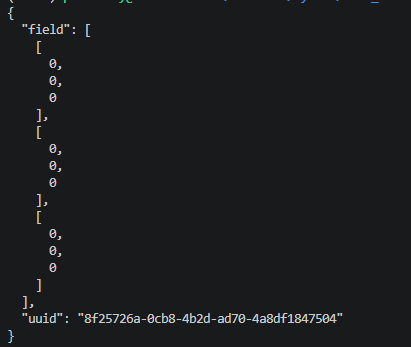

# tic_tac_toe_web

## Коротко о программе.

Данный проект представляет из себя игру крестики-нолики, а точнее серверную ее часть. Она была создана в учебных целях, чтобы автор немного разобрался с тем, как работает Flask.

## Как запустить игру(Linux).

1. Скачиваем папку src, заходим в нее через командную строку.
2. Запускаем сервер командой python main.py.
3. Открываем новый терминал и вводим команду curl -X POST http://127.0.0.1:5000/game
для загрузки игрового поля. Получаем такое вот поле(особенности обработки json'а flask'ом):

    

4. Копируем uuid и вставляем в строку, а также меняем любоq ноль на двойку(ход игрока, я сделаю его на(0,0)) curl -X POST http://127.0.0.1:5000/game/[uuid] -H 'Content-Type: application/json' -d '{"field": [[2,0,0], [0,0,0],[0,0,0]]}'
5. Делаем ходы, смотрим ходы компьютера(ходы компьютера также вносим в json вручную) и так до победного конца! Как только на поле выпадет победная комбинация компьютер перестанет ходить.
6. Игровых полей может быть несколько.
